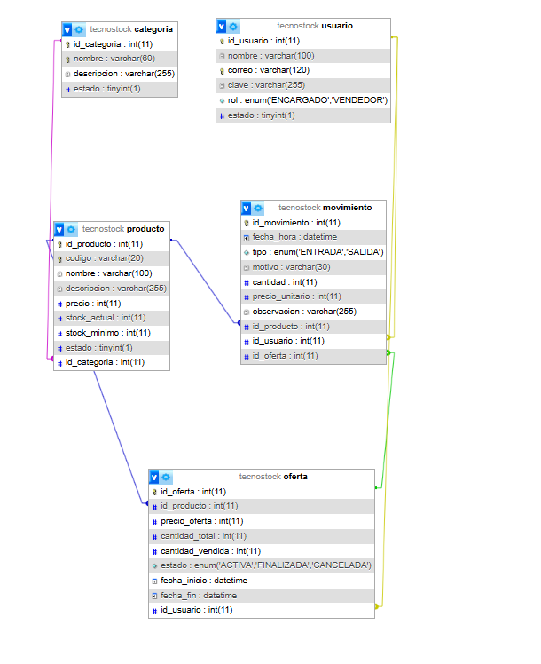

# TecnoStock – Sistema de inventario web

Proyecto del ramo Sistemas de Información (Caso 1).
Autor: Nicolas Tapia

## 1. Problema

TecnoStock es una tienda de accesorios tecnológicos que lleva su inventario en una planilla. Eso le trae varios problemas:

| Problema | Cómo lo resuelve el sistema |
|---|---|
| Productos con el mismo código | El código es único en la base de datos y se revisa antes de guardar |
| Cantidades que no cuadran | El stock solo cambia registrando entradas y salidas |
| No se sabe bien cuánto queda | Listado con búsqueda y aviso cuando un producto queda bajo su mínimo |
| Las ventas no quedan registradas | Cada venta se guarda con su total, y el inicio muestra las ventas de la semana |

## 2. Objetivo

Hacer una aplicación web conectada a una base de datos para registrar, buscar, editar y desactivar productos, y controlar las entradas y salidas de stock sin perder información.

## 3. Usuarios

El sistema tiene dos roles:

- **Encargado de inventario:** maneja todo (productos, categorías, ofertas y cualquier movimiento).
- **Vendedor:** registra ventas, carga stock que llega del proveedor y consulta la información.

| Acción | Encargado | Vendedor |
|---|:---:|:---:|
| Ver inicio, productos, ofertas e historial | Sí | Sí |
| Registrar ventas | Sí | Sí |
| Cargar stock (compra a proveedor) | Sí | Sí |
| Otros movimientos (producto dañado, devoluciones, ajustes) | Sí | No |
| Crear, editar, desactivar o eliminar productos | Sí | No |
| Manejar categorías | Sí | No |
| Crear y cancelar ofertas | Sí | No |

Los permisos se revisan en PHP. No basta con esconder los botones: si un vendedor escribe a mano la dirección de una página que no le corresponde, el sistema lo devuelve al inicio.

## 4. Alcance

Lo que hace el sistema:

- Inicio y cierre de sesión con los dos roles.
- Categorías: crear, listar, editar y desactivar.
- Productos: crear, listar, buscar, editar y desactivar.
- Ventas, carga de stock y otros movimientos, con un historial que se puede filtrar.
- Aviso de productos con stock bajo el mínimo.
- Ofertas para una cantidad de unidades, que se terminan solas cuando se venden.
- Inicio con un resumen del día y un gráfico de ventas de los últimos 7 días.

Lo que queda fuera:

- Boletas o facturas.
- Proveedores y clientes.
- Crear usuarios desde la página (los usuarios vienen en el script SQL).

## 5. Requerimientos funcionales

| ID | Requerimiento |
|---|---|
| RF01 | Iniciar sesión con un usuario registrado. |
| RF02 | Registrar productos con código, nombre, categoría, descripción, precio, stock y stock mínimo. |
| RF03 | Ver el listado de productos. |
| RF04 | Buscar productos por nombre, código o categoría. |
| RF05 | Editar precio, descripción, categoría y stock mínimo de un producto. |
| RF06 | Desactivar productos que ya no se venden. |
| RF07 | Registrar entradas y salidas de stock. |
| RF08 | Avisar cuando el stock de un producto queda bajo su mínimo. |
| RF09 | Manejar las categorías de productos. |
| RF10 | Ver el historial de movimientos y filtrarlo por tipo, motivo, producto y fechas. |
| RF11 | Registrar ventas con el total calculado automáticamente. |
| RF12 | Tener dos roles con permisos distintos (Encargado y Vendedor). |
| RF13 | Crear ofertas con un precio especial para cierta cantidad de unidades. |
| RF14 | Volver al precio normal cuando se venden todas las unidades de la oferta. |
| RF15 | Mostrar un gráfico con las ventas de los últimos 7 días. |

## 6. Requerimientos no funcionales

| ID | Requerimiento |
|---|---|
| RNF01 | La interfaz tiene que ser fácil de usar para alguien que no sabe de computación, con mensajes claros. |
| RNF02 | Tiene que funcionar en un servidor local con XAMPP. |
| RNF03 | Todas las consultas a la base de datos usan consultas preparadas (PDO). |
| RNF04 | Las contraseñas se guardan cifradas con `password_hash`. |
| RNF05 | Los datos se validan en el navegador (JavaScript) y otra vez en el servidor (PHP). |
| RNF06 | La página se adapta al tamaño de la pantalla (Bootstrap). |
| RNF07 | Las páginas internas solo se pueden ver con la sesión iniciada. |
| RNF08 | Los formularios están protegidos contra CSRF y los datos se muestran escapados para evitar XSS. |

## 7. Reglas de negocio

| ID | Regla | Dónde se controla |
|---|---|---|
| RN01 | No puede haber dos productos con el mismo código. | Base de datos (`UNIQUE`) y PHP |
| RN02 | Precio, stock, stock mínimo y cantidad no pueden ser negativos. | Base de datos (`CHECK`), PHP y JavaScript |
| RN03 | Cada movimiento guarda fecha, tipo, cantidad, producto y quién lo hizo. | Base de datos (`NOT NULL` y claves foráneas) y PHP |
| RN04 | Una salida no puede dejar el stock bajo cero. | PHP y base de datos (`CHECK`) |
| RN05 | Un producto con movimientos no se borra, se desactiva. | Base de datos (`RESTRICT`) y PHP |
| RN06 | El stock se actualiza solo después de cada movimiento válido. | PHP (transacción) |
| RN07 | El motivo tiene que corresponder al tipo de movimiento (entrada o salida). | PHP y JavaScript |
| RN08 | No se puede desactivar una categoría que tenga productos activos. | PHP |
| RN09 | Cada rol solo puede hacer lo que tiene permitido. | PHP (sesión) |
| RN10 | Un producto tiene como máximo una oferta activa, con precio menor al normal y sin superar el stock. | PHP, JavaScript y base de datos (`CHECK`) |
| RN11 | La oferta termina sola al venderse todas sus unidades, y el precio normal del producto no se toca. | PHP (transacción) |

## 8. Decisiones de diseño

- **El stock no se edita a mano.** Al crear un producto se ingresa su stock inicial y queda guardado como una entrada. Desde ahí solo cambia con entradas y salidas, así cada cambio queda en el historial.
- **No se borra, se desactiva.** Productos y categorías tienen un campo `estado`. Desactivarlos en vez de borrarlos mantiene el historial completo.
- **Transacciones.** Al registrar un movimiento, el stock y el movimiento se guardan juntos: si algo falla, no se guarda nada. Además bloqueo la fila del producto con `FOR UPDATE` para que dos ventas al mismo tiempo no dejen el stock en negativo.
- **Ofertas aparte.** La oferta tiene su propia tabla y no cambia el precio del producto. Si alguien compra más unidades de las que quedan en oferta, la venta se guarda en dos movimientos: una parte con precio de oferta y el resto con precio normal.
- **Seguridad.** Uso consultas preparadas, contraseñas cifradas, token CSRF en los formularios y `htmlspecialchars` al mostrar datos. Desde el navegador solo se puede entrar a la carpeta `public/`; el resto del código, el script SQL y la documentación están bloqueados.
- **Frontend y backend separados.** Cada pantalla tiene un controlador en `public/` (permisos, validaciones y consultas) y una vista en `app/vistas/` (el HTML con Bootstrap).

## 9. Tecnologías

| Para qué | Qué usé |
|---|---|
| Editor | Visual Studio Code |
| Servidor local | XAMPP (Apache y MariaDB) |
| Base de datos | MySQL / MariaDB con phpMyAdmin |
| Interfaz | HTML, Bootstrap 5 y Bootstrap Icons |
| Gráfico | Chart.js |
| Backend | PHP 8 con PDO |
| Validaciones en el navegador | JavaScript |
| Control de versiones | Git y GitHub |

## 10. Cómo instalarlo

1. Instalar XAMPP y encender Apache y MySQL.
2. Copiar el proyecto en `C:\xampp\htdocs\tecnostock`.
3. Entrar a `http://localhost/phpmyadmin` e importar `database/tecnostock.sql`.
4. Abrir `http://localhost/tecnostock`. El `.htaccess` de la raíz manda todo a la carpeta `public/` (usa `mod_rewrite`, que XAMPP trae activado).
5. Entrar con una de las cuentas de prueba:

| Rol | Correo | Contraseña |
|---|---|---|
| Encargado | admin@tecnostock.cl | admin123 |
| Vendedor | vendedor@tecnostock.cl | vendedor123 |

En el login hay botones que llenan estos datos.

## 11. Estructura del proyecto

```
tecnostock/
├── .htaccess          manda todas las direcciones a public/
├── public/            lo único que se puede abrir desde el navegador
│   ├── assets/        estilos.css, validaciones.js y grafico.js
│   ├── index.php      login
│   ├── inicio.php     panel de inicio
│   ├── logout.php     cerrar sesión
│   ├── categorias/    controladores de categorías
│   ├── productos/     controladores de productos
│   ├── movimientos/   historial y registro de ventas y movimientos
│   └── ofertas/       controladores de ofertas
├── app/               backend, bloqueado para el navegador
│   ├── config/        conexion.php (conexión a MySQL con PDO)
│   ├── nucleo/        funciones separadas por tema: seguridad, navegacion,
│   │                  validacion, formato e inventario, más arranque.php y sesion.php
│   └── vistas/        el HTML de cada pantalla (layout/ tiene el menú y el pie)
├── database/          script SQL
└── docs/              diagrama ER, casos de prueba y capturas
```

Por ejemplo, al abrir `localhost/tecnostock/productos/form.php`:

1. El `.htaccess` lo lleva a `public/productos/form.php`, que es el controlador.
2. El controlador revisa la sesión y los permisos, valida lo que llegó del formulario y hace las consultas.
3. Al final carga la vista `app/vistas/productos/form.php`, que muestra el formulario.

## 12. Base de datos



| Tabla | Qué guarda |
|---|---|
| `usuario` | Las personas que usan el sistema y su rol |
| `categoria` | Las categorías de productos |
| `producto` | Los productos con su precio, stock y stock mínimo |
| `movimiento` | Cada entrada o salida, quién la hizo y, si aplica, la oferta usada |
| `oferta` | Los precios especiales para cierta cantidad de unidades |

## 13. Pruebas

Probé el sistema con 27 casos: login, permisos, categorías, productos, ventas, stock y ofertas. Están en [docs/casos_de_prueba.md](docs/casos_de_prueba.md), y algunas capturas en [docs/evidencias](docs/evidencias/). Los 27 casos pasaron.