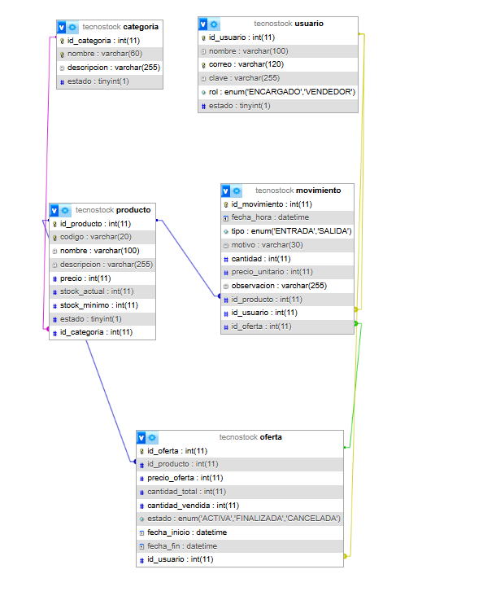

# TecnoStock – Sistema de Inventario Web

Proyecto del ramo **Sistemas de Información** – Caso 1.
Autor: Nicolas Tapia

---

## 1. Problema

TecnoStock es un emprendimiento que vende accesorios tecnológicos. Hoy registra sus productos en una planilla, lo que provoca:

| Problema actual | Cómo lo resuelve el sistema |
|---|---|
| Códigos de producto duplicados | El código es único en la base de datos (`UNIQUE`) y se valida antes de guardar |
| Errores en las cantidades disponibles | El stock solo cambia mediante movimientos registrados (entradas y salidas) |
| Poca claridad del stock real | Listado con búsqueda, barra de nivel de stock y alerta de productos con bajo stock |
| Ventas sin registro ni total claro | Registro de ventas con cálculo automático del total y gráfico de los últimos 7 días |

## 2. Objetivo

Construir una aplicación web, conectada a una base de datos relacional, que permita registrar, consultar, actualizar y desactivar productos, y controlar sus entradas y salidas de inventario, manteniendo la integridad de la información.

## 3. Actor

| Actor | Responsabilidad |
|---|---|
| **Encargado de inventario** | Administra todo: productos, categorías, ofertas y cualquier tipo de movimiento |
| **Vendedor** | Registra ventas, carga stock (compra a proveedor) y consulta productos, ofertas e historial |

### Permisos por rol

| Acción | Encargado | Vendedor |
|---|:---:|:---:|
| Ver inicio, productos, ofertas e historial | ✅ | ✅ |
| Registrar venta | ✅ | ✅ |
| Cargar stock (compra a proveedor) | ✅ | ✅ |
| Otros movimientos (producto dañado, devoluciones, ajustes) | ✅ | ❌ |
| Crear, editar, desactivar o eliminar productos | ✅ | ❌ |
| Gestionar categorías | ✅ | ❌ |
| Crear y cancelar ofertas | ✅ | ❌ |

Los permisos se controlan en el servidor (PHP), no solo ocultando botones: si un vendedor escribe la dirección de una página restringida, el sistema lo redirige.

## 4. Alcance

**Incluye:**
- Inicio y cierre de sesión con dos roles (Encargado y Vendedor).
- Gestión de categorías (crear, listar, editar, desactivar).
- Gestión de productos (crear, listar, buscar, editar, desactivar).
- Registro de ventas, carga de stock y otros movimientos, con historial y filtros.
- Alerta de productos con stock bajo el mínimo.
- Ofertas por cantidad de unidades, que terminan solas al venderse.
- Panel de inicio con resumen y gráfico de ventas de los últimos 7 días.

**No incluye:**
- Facturación ni boletas electrónicas.
- Gestión de proveedores o clientes.
- Registro de usuarios desde la interfaz (los usuarios se crean en el script SQL).

## 5. Requerimientos funcionales

| ID | Requerimiento |
|---|---|
| RF01 | El sistema debe permitir iniciar sesión con un usuario previamente registrado. |
| RF02 | El sistema debe permitir registrar productos con código, nombre, categoría, descripción, precio, stock actual y stock mínimo. |
| RF03 | El sistema debe mostrar el listado de productos. |
| RF04 | El sistema debe permitir buscar productos por nombre, código o categoría. |
| RF05 | El sistema debe permitir modificar el precio, la descripción, la categoría y el stock mínimo de un producto. |
| RF06 | El sistema debe permitir desactivar productos que ya no se comercializan. |
| RF07 | El sistema debe permitir registrar entradas y salidas de existencias. |
| RF08 | El sistema debe mostrar una alerta cuando el stock actual sea menor que el stock mínimo. |
| RF09 | El sistema debe permitir gestionar categorías de productos. |
| RF10 | El sistema debe mostrar el historial de movimientos, con filtros por tipo, motivo, producto y fechas. |
| RF11 | El sistema debe permitir registrar ventas, calculando el total automáticamente. |
| RF12 | El sistema debe distinguir dos roles con permisos distintos (Encargado y Vendedor). |
| RF13 | El sistema debe permitir crear ofertas con precio especial para una cantidad de unidades de un producto. |
| RF14 | El sistema debe volver al precio normal cuando se vendan todas las unidades de la oferta. |
| RF15 | El sistema debe mostrar un gráfico con las ventas de los últimos 7 días. |

## 6. Requerimientos no funcionales

| ID | Requerimiento |
|---|---|
| RNF01 | La interfaz debe ser comprensible para un usuario no técnico, con mensajes claros. |
| RNF02 | El sistema debe funcionar en un servidor local (XAMPP). |
| RNF03 | Todas las consultas a la base de datos deben usar consultas preparadas (PDO). |
| RNF04 | Las contraseñas deben almacenarse cifradas (`password_hash`). |
| RNF05 | Las validaciones deben hacerse en el cliente (JavaScript) y repetirse en el servidor (PHP). |
| RNF06 | La interfaz debe ser responsiva (Bootstrap). |
| RNF07 | Las páginas internas solo deben ser accesibles con sesión iniciada. |
| RNF08 | Los formularios deben estar protegidos contra CSRF y los datos mostrados escapados contra XSS. |

## 7. Reglas de negocio

| ID | Regla | Dónde se controla |
|---|---|---|
| RN01 | El código de producto no puede repetirse. | BD (`UNIQUE`) + PHP |
| RN02 | Precio, stock actual, stock mínimo y cantidad no pueden ser negativos. | BD (`CHECK`) + PHP + JS |
| RN03 | Todo movimiento registra fecha, tipo, cantidad, producto y usuario responsable. | BD (`NOT NULL`, FK) + PHP (sesión) |
| RN04 | Una salida no puede dejar el stock bajo cero. | PHP + BD (`CHECK`) |
| RN05 | Un producto con movimientos se desactiva; no se elimina físicamente. | BD (FK `RESTRICT`) + PHP |
| RN06 | El stock se actualiza automáticamente después de cada movimiento válido. | PHP (transacción) |
| RN07 | El motivo de un movimiento debe corresponder a su tipo (entrada o salida). | PHP + JS |
| RN08 | No se puede desactivar una categoría que tenga productos activos. | PHP |
| RN09 | Cada rol solo puede realizar las acciones que tiene permitidas. | PHP (sesión) |
| RN10 | Un producto solo puede tener una oferta activa, con precio menor al normal y cantidad no mayor al stock. | PHP + JS + BD (`CHECK`) |
| RN11 | Una oferta termina sola al venderse todas sus unidades; el precio normal del producto nunca se modifica. | PHP (transacción) |

## 8. Decisiones de diseño

- **El stock solo cambia mediante movimientos.** Al crear un producto se ingresa su stock inicial, que queda registrado como una entrada. Después, el stock no se edita a mano: se registran entradas o salidas. Así cada cambio queda trazable y se evitan los errores de la planilla.
- **Borrado lógico.** Productos y categorías tienen un campo `estado` (activo/inactivo) en vez de eliminarse, para conservar el historial.
- **Transacciones.** Registrar un movimiento y actualizar el stock ocurren dentro de una misma transacción: si una parte falla, no se guarda ninguna. Además, la fila del producto se bloquea (`FOR UPDATE`) para que dos ventas simultáneas no dejen el stock negativo.
- **Ofertas en su propia tabla.** Una oferta no cambia el precio del producto: guarda su precio, cuántas unidades cubre y cuántas lleva vendidas. Si una venta supera las unidades que quedan en oferta, se registra en dos movimientos (una parte a precio de oferta y otra a precio normal), y cada movimiento con oferta guarda `id_oferta` para poder auditarlo.
- **Seguridad.** Consultas preparadas (PDO), contraseñas con `password_hash`, token CSRF en todos los formularios POST, escape de datos con `htmlspecialchars` y bloqueo de carpetas internas con `.htaccess`.

## 9. Tecnologías

| Propósito | Herramienta |
|---|---|
| Editor | Visual Studio Code |
| Servidor local | XAMPP (Apache + MariaDB) |
| Base de datos | MySQL / MariaDB + phpMyAdmin |
| Interfaz | HTML5 + Bootstrap 5 + Bootstrap Icons |
| Gráficos | Chart.js |
| Servidor | PHP 8 + PDO |
| Validaciones | JavaScript |
| Versionamiento | Git + GitHub |

## 10. Instalación

1. Instalar XAMPP e iniciar Apache y MySQL.
2. Clonar o copiar este repositorio en `C:\xampp\htdocs\tecnostock`.
3. Abrir `http://localhost/phpmyadmin` e importar `database/tecnostock.sql`.
4. Abrir `http://localhost/tecnostock`.
5. Ingresar con una de las cuentas de prueba:

| Rol | Correo | Contraseña |
|---|---|---|
| Encargado | admin@tecnostock.cl | admin123 |
| Vendedor | vendedor@tecnostock.cl | vendedor123 |

> Son cuentas de demostración. En la pantalla de inicio de sesión hay botones que rellenan estos datos.

## 11. Estructura del proyecto

```
tecnostock/
├── assets/        CSS y JavaScript (validaciones y gráfico)
├── categorias/    CRUD de categorías
├── config/        Conexión a la base de datos
├── database/      Script SQL
├── docs/          Diagrama ER, casos de prueba y evidencias
├── includes/      Encabezado, pie y control de sesión
├── movimientos/   Ventas, carga de stock, otros movimientos e historial
├── ofertas/       Crear, listar y cancelar ofertas
├── productos/     CRUD de productos
├── index.php      Inicio de sesión
└── inicio.php     Panel de inicio con resumen y gráfico
```

## 12. Modelo de datos



| Tabla | Contenido |
|---|---|
| `usuario` | Personas que usan el sistema y su rol |
| `categoria` | Agrupación de productos |
| `producto` | Productos con precio, stock actual y stock mínimo |
| `movimiento` | Cada entrada o salida de stock, con su usuario y, si corresponde, la oferta aplicada |
| `oferta` | Precio especial para una cantidad de unidades de un producto |